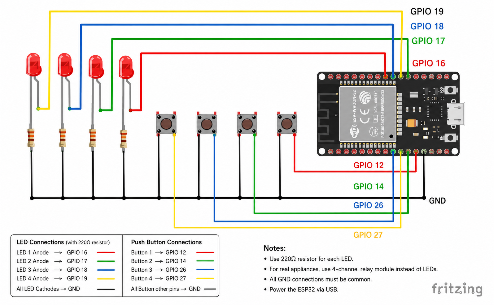

# ESP32 Smart Home Automation

<p align="center">
  
</p>

A Wi-Fi based Home Automation System built using the ESP32 microcontroller. This project allows users to control multiple devices through a web interface and physical push buttons. The system supports real-time status updates and can be expanded using relay modules for controlling household appliances.

---

## Features

* Web-based control panel
* Physical push button control
* Real-time device status updates
* Wi-Fi connectivity
* Reset all outputs functionality
* Mobile-friendly interface
* mDNS support (`esp32.local`)
* Compatible with LEDs and relay modules

---

## Hardware Requirements

| Component       | Quantity    |
| --------------- | ----------- |
| ESP32 DevKit V1 | 1           |
| Push Buttons    | 4           |
| LEDs            | 4           |
| 220Ω Resistors  | 4           |
| Breadboard      | 1           |
| Jumper Wires    | As Required |

### Optional Components

| Component              | Quantity |
| ---------------------- | -------- |
| 4-Channel Relay Module | 1        |

---

## Pin Configuration

### Output Pins

| Output   | GPIO    |
| -------- | ------- |
| Output 1 | GPIO 16 |
| Output 2 | GPIO 17 |
| Output 3 | GPIO 18 |
| Output 4 | GPIO 19 |

### Input Pins

| Button   | GPIO    |
| -------- | ------- |
| Button 1 | GPIO 12 |
| Button 2 | GPIO 14 |
| Button 3 | GPIO 26 |
| Button 4 | GPIO 27 |

---

## Circuit Description 

The ESP32 hosts a web server that allows users to control four outputs from any device connected to the same Wi-Fi network. Each output can be controlled through both the web interface and a dedicated physical push button.

* GPIO 16, 17, 18 and 19 are configured as outputs.
* GPIO 12, 14, 26 and 27 are configured as button inputs using `INPUT_PULLUP`.
* LEDs can be replaced with relay modules for controlling household appliances.
* All grounds must be connected together.

---

## Software Requirements

* Arduino IDE
* ESP32 Board Package
* AsyncTCP
* ESPAsyncWebServer
* ESPmDNS

---

## Installation

### Clone Repository

```bash
git clone https://github.com/heychandu/Esp-32-based-home-automation.git
```

### Configure Wi-Fi

Update the following lines in the source code:

```cpp
const char* ssid = "YOUR_WIFI_NAME";
const char* password = "YOUR_WIFI_PASSWORD";
```

### Upload Code

1. Connect ESP32 to your computer.
2. Open the project in Arduino IDE.
3. Select **ESP32 Dev Module**.
4. Install the required libraries.
5. Compile and upload the code.
6. Open Serial Monitor at **115200 baud**.

---

## Accessing the Web Interface

After uploading the code and connecting to Wi-Fi, open a browser on the same network and visit:

```text
http://esp32.local
```

or

```text
http://<ESP32-IP-ADDRESS>
```

The web interface allows you to:

* Toggle individual outputs
* Monitor device states in real time
* Reset all outputs with a single click

---

## Project Structure

```text
Esp-32-based-home-automation/
│
├── src/
│   └── main.ino
│
├── images/
│   └── circuit-diagram.png
│
└── README.md
```

---

## Future Enhancements 

* MQTT Integration
* Home Assistant Integration
* Mobile Application
* Authentication System
* Device Scheduling
* Energy Monitoring
* Voice Assistant Support

---

## Author

Chandu R

GitHub: https://github.com/heychandu
